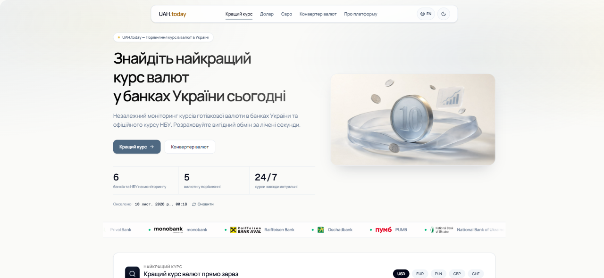
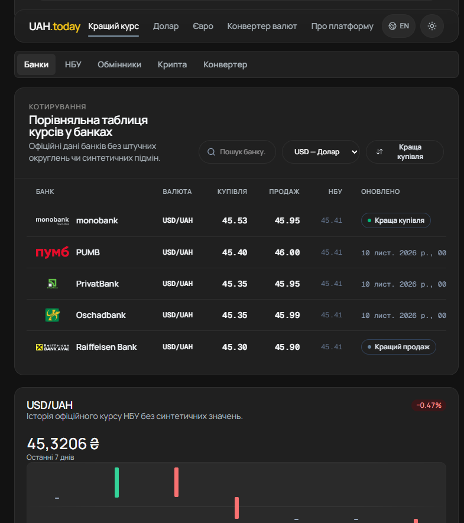
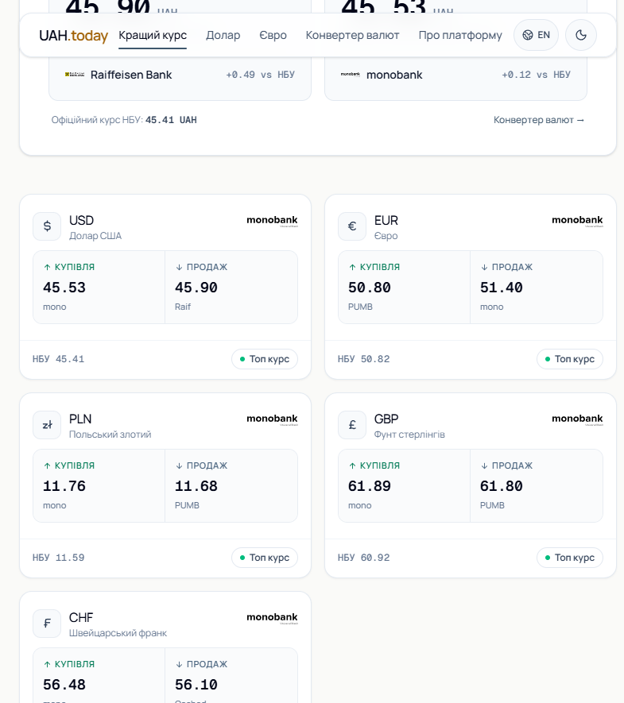
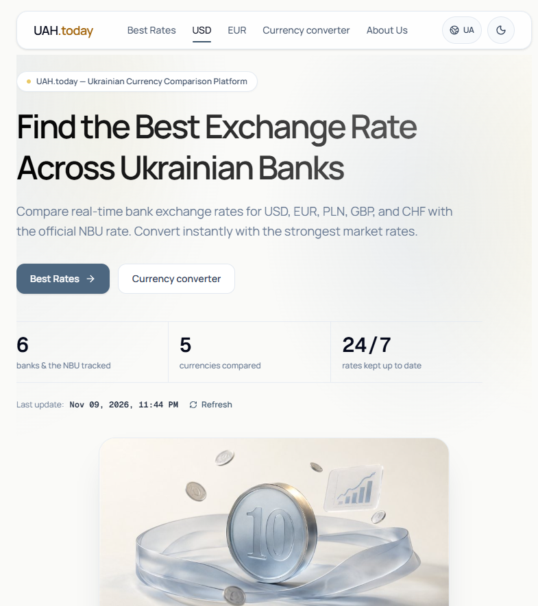

# UAH.today — Ukrainian Currency Exchange Comparison Platform

[](https://github.com/devcodex2025/exchange-rates-ukraine/actions)
[](LICENSE)
[](https://exchange-rates-ukraine.vercel.app/)
[](https://www.skills.sh)

**UAH.today** is a modern, high-performance currency comparison platform that helps people find the best exchange rates across Ukrainian banks and the National Bank of Ukraine (NBU).

| Dashboard · light theme | Bank comparison table · dark theme |
|---|---|
|  |  |
| **Currency overview cards** | **English version** |
|  |  |

**Try it live:** [exchange-rates-ukraine.vercel.app](https://exchange-rates-ukraine.vercel.app/) (UA) · [exchange-rates-ukraine.vercel.app/en](https://exchange-rates-ukraine.vercel.app/en) (EN)

**Contents**: [1. Purpose](#1-product-purpose--identity) · [2. USP](#2-unique-value-proposition-usp) · [3. Currencies & Institutions](#3-supported-currencies--institutions) · [4. Architecture](#4-architecture-overview) · [5. Tech Stack](#5-technology-stack) · [6. Installation](#6-installation--development) · [7. Env Variables](#7-environment-variables) · [8. API](#8-machine-readable-api--open-data) · [9. Skills for AI Agents](#9-skills-for-ai-agents-installable) · [10. AdSense](#10-google-adsense--policy-compliance) · [11. Contributing](#11-contributing) · [12. License](#12-license)

---

## 1. Product Purpose & Identity

**UAH.today — Find the best exchange rate in Ukraine.**

The platform answers three vital questions for consumers and businesses:
1. **Where can I buy foreign currency at the best price?**
2. **Where can I sell foreign currency at the best price?**
3. **How much will my money be worth when converted between different institutions?**

---

## 2. Unique Value Proposition (USP)

- **Best Rate Finder**: Automatically identifies the best available retail buy and sell rates across supported banks independently (avoiding confusing single-bank conflations).
- **Real-time Bank Comparison**: Transparent side-by-side comparison across top Ukrainian financial institutions with explicit timestamps and freshness states.
- **Smart Currency Converter**: Instantly computes bidirectional exchange using the best available bank rate or a customer-selected bank.
- **Transparent Data Sources**: Every quote is tagged with its origin provider, fetch timestamp, and freshness status. Never fabricates numbers or substitutes missing values with zeroes.
- **Currency Market Insights**: Live spread calculations, variance ranges, and deviation from the official NBU central bank rate.
- **Speed & Privacy**: Mobile-first architecture, no mandatory login or personal telemetry, WCAG 2.2 AA accessibility, and instant navigation.

---

## 3. Supported Currencies & Institutions

### Supported Currencies
- **USD** — US Dollar ($)
- **EUR** — Euro (€)
- **PLN** — Polish Zloty (zł)
- **GBP** — British Pound (£)
- **CHF** — Swiss Franc (Fr)

### Supported Institutions
- **National Bank of Ukraine (NBU)** — Official central bank benchmark API
- **PrivatBank** — Official public exchange API
- **monobank** — Verified official retail API
- **Raiffeisen Bank** — Real-time bank feed
- **Oschadbank** — Real-time bank feed
- **PUMB** — Real-time bank feed

---

## 4. Architecture Overview

```
├── server.ts                        # Express dev server (mirrors Vercel behavior incl. prerendered routes)
├── api/                             # Vercel Serverless Functions
│   ├── rates.ts                     # /api/rates endpoint with CDN caching
│   └── history.ts                   # /api/history NBU historical archive endpoint
├── src/
│   ├── components/                  # React UI Components
│   │   ├── BestRateFinder.tsx       # Top buy/sell rate comparison widget
│   │   ├── RatesTable.tsx           # Sortable, searchable comparison table
│   │   ├── CurrencyCard.tsx         # Currency overview cards
│   │   ├── CurrencyConverter.tsx    # Smart bidirectional converter
│   │   ├── MarketInsights.tsx       # Spreads, variance and NBU difference
│   │   ├── UsdHistoryChart.tsx      # NBU daily-rate history chart
│   │   ├── SourcesTicker.tsx        # Full-bleed live source-health ticker band
│   │   ├── SiteHeader.tsx           # Navigation, locale & theme switcher
│   │   ├── EditorialContent.tsx     # Topic-specific SEO guides
│   │   ├── CookieConsent.tsx        # GDPR & AdSense compliant consent banner
│   │   ├── AdSlot.tsx               # Non-intrusive AdSense ready slot
│   │   └── ui/                      # Reusable primitives (button, card, pop-number, …)
│   ├── lib/
│   │   ├── rates.ts                 # Response types & derived-rate helpers
│   │   ├── rates/
│   │   │   ├── normalize.ts         # Rate normalization & conversions
│   │   │   └── validation.ts        # Number sanitation & rate bounds check
│   │   ├── useScrollReveal.ts       # Scroll-triggered reveal hook
│   │   └── utils.ts
│   ├── pages/                       # Routed pages (UA & EN)
│   │   ├── Dashboard.tsx            # Main high-performance dashboard
│   │   ├── About.tsx                # About Us & methodology
│   │   ├── Contact.tsx              # Contact information (mailto feedback)
│   │   ├── SkillsPage.tsx           # Human-readable docs for the agent skill
│   │   ├── AddBankPage.tsx          # Contributor guide (add a bank source)
│   │   ├── PrivacyPolicy.tsx        # Detailed GDPR & AdSense policy
│   │   ├── Terms.tsx                # Terms of Use & legal disclaimer
│   │   └── NotFound.tsx
│   ├── services/
│   │   ├── cache/
│   │   │   └── cache.service.ts     # In-memory deduplicating cache
│   │   └── rates/                   # Isolated bank provider clients
│   │       ├── nbu.service.ts
│   │       ├── privatbank.service.ts
│   │       ├── monobank.service.ts
│   │       ├── raiffeisen.service.ts
│   │       ├── oschadbank.service.ts
│   │       ├── pumb.service.ts
│   │       ├── minfin.service.ts    # minfin.com.ua cash-rate feeds (server-rendered, no key)
│   │       └── rates-aggregator.service.ts
│   ├── constants.ts                 # Localized copy, currencies & bank metadata
│   └── index.css                    # Tailwind CSS styling
├── .agents/
│   └── skills/
│       └── uah-today-api/           # Installable AI-agent skill (markdown, see §9)
│           ├── SKILL.md             # API reference & data semantics
│           └── playbooks.md         # Task recipes for coding agents
├── docs/
│   └── screenshots/                 # App screenshots used in this README
├── scripts/
│   ├── check-i18n.mjs               # Automated localization leak test
│   └── prerender.mjs                # SSG generator for 27 prerendered SEO routes
└── tests/
    └── rates.test.ts                # Unit tests for calculations & validation
```

---

## 5. Technology Stack

- **Frontend**: React 19, TypeScript 5.8, Tailwind CSS v4, Lucide Icons
- **Build & Bundle**: Vite 6, Static Prerendering (SSG)
- **Backend / API**: Express 4, Node.js 22, Vercel Serverless Functions
- **Testing**: Node Native Test Runner, TSX, Vitest compatible
- **Deployment**: Vercel Edge Network with stale-while-revalidate caching

---

## 6. Installation & Development

### Prerequisites
- Node.js >= 20.0.0
- npm >= 9.0.0

### Getting Started

1. **Clone the repository**:
   ```bash
   git clone https://github.com/devcodex2025/exchange-rates-ukraine.git
   cd exchange-rates-ukraine
   ```

2. **Install dependencies**:
   ```bash
   npm install
   ```

3. **Configure environment (optional)**:
   ```bash
   cp .env.example .env
   ```

4. **Start development server**:
   ```bash
   npm run dev
   ```
   Open `http://localhost:3000` in your browser.

5. **Run test suite**:
   ```bash
   npm test
   npm run check:i18n
   npm run lint
   ```

6. **Build for production with Prerendering (SSG)**:
   ```bash
   npm run build
   ```

---

## 7. Environment Variables

| Variable | Description | Default |
|---|---|---|
| `VITE_SITE_URL` | Canonical origin URL for SEO & sitemaps | `https://exchange-rates-ukraine.vercel.app` |
| `PORT` | Local dev server port | `3000` |

---

## 8. Machine-Readable API & Open Data

UAH.today provides open endpoints for search crawlers, research, and AI integrations (see [Section 9](#9-skills-for-ai-agents-installable) for the turn-key agent skill):

**Browser-ready**: every endpoint answers with `Access-Control-Allow-Origin: *` — a plain GET, no preflight, no keys. A news site or blog can embed live rates with zero server code; a ready copy-paste client ships with the agent skill ([playbooks.md §7](.agents/skills/uah-today-api/playbooks.md)).

### 1. `GET /api/rates` (or `/rates.json`)
Returns real-time aggregated rates across all supported banks. Edge-cached 15 min (`s-maxage=900`; `?fresh=1` bypasses).

**Response Structure:**
```json
{
  "base": "UAH",
  "updatedAt": "2026-11-09T03:30:00.000Z",
  "nbu": [
    { "cc": "USD", "rate": 41.35 }
  ],
  "privat": [
    { "ccy": "USD", "buy": 41.10, "sale": 41.60 }
  ],
  "mono": [
    { "currencyCodeA": 840, "currencyCodeB": 980, "rateBuy": 41.25, "rateSell": 41.55 }
  ],
  "sources": {
    "privat": {
      "sourceName": "PrivatBank API",
      "status": "fresh",
      "isStale": false,
      "fetchedAt": "2026-11-09T03:30:00.000Z"
    }
  }
}
```

### 2. `GET /api/history?currency=USD&days=7`
Returns official NBU historical data points (7, 30, or 90 days).

### 3. `GET /llms.txt`
Structured reference guide for Large Language Models and AI agents.

---

## 9. Skills for AI Agents (Installable)

UAH.today ships an **installable agent skill** — plain markdown, no keys, no auth — that teaches any coding agent (OpenCode, Claude Code, Cursor, Codex CLI, …) to use the open rates API correctly: exact response schemas, caching behavior, and the gotchas that silently corrupt rate answers.

**Skill files** (both live in this repository at `.agents/skills/uah-today-api/` and are served raw from `main`):

| File | Purpose |
|---|---|
| [`SKILL.md`](.agents/skills/uah-today-api/SKILL.md) | Complete API reference: `/api/rates` and `/api/history` schemas, rate semantics (`buy` vs `sell` vs NBU reference), monobank numeric currency-code map, `rateCross` fallback, per-source health states, cache TTLs |
| [`playbooks.md`](.agents/skills/uah-today-api/playbooks.md) | Task recipes: best buy/sell scan per currency, spread vs NBU, direction-correct conversion math, history → CSV / trend summaries, and a drop-in "rate today" embed block for news sites (§7) |

**What the skill enforces** (the agent follows these rules from the markdown alone):

- `buy` is used when selling FX for UAH; `sell` when buying FX — never swapped.
- Missing bank quotes stay `null` — no fabrication, no substituting NBU values for bank rates.
- monobank rows are *card* rates, matched by numeric ISO code (`840`=USD, `978`=EUR, `826`=GBP, `756`=CHF, `985`=PLN) and keyed on `currencyCodeB === 980`.
- Stale/unavailable sources are retried once with `?fresh=1`, then reported with `sourceUpdatedAt` timestamps.

**Examples of what the agent can answer after installing:**

- «Де найвигідніше продати 1000 доларів за гривню сьогодні? Покажи курси всіх банків і час оновлення.»
- «Картковий чи готівковий курс: як найдешевше купити 500 євро, враховуючи відділення.»
- «Збери CSV офіційного курсу долара НБУ за останні 30 днів і підсумуй тренд.»
- «Додай на наш новинний сайт блок курсу долара сьогодні: найкращий курс купівлі та продажу USD у банках, офіційний курс НБУ, час оновлення й атрибуція — готовий embed-код входить у скіл (playbook №7).»
- "Add a 'USD today' block to our news site: best buy and sell prices across banks, the official NBU rate, update time, and a 'Data: UAH.today' credit — the embed snippet ships with the skill (playbook #7)."

### Installation

**Recommended: one line** via the open [skills CLI](https://www.skills.sh) (requires Node.js 22.20+). It auto-detects installed agents — OpenCode, Claude Code, Codex, Cursor and 75+ more — and writes the skill into each agent's canonical project directory (OpenCode: `.opencode/skills/`, Claude Code: `.claude/skills/`):

```bash
npx skills add devcodex2025/exchange-rates-ukraine --skill uah-today-api -y
```

Afterwards, `npx skills update` keeps the skill current and `npx skills list` shows what is installed.

<details>
<summary>No Node.js? Manual curl fallback</summary>

```bash
# shell function that copies the files straight from the repository
install_skill() {
  mkdir -p "$1/uah-today-api"
  curl -fsSL https://raw.githubusercontent.com/devcodex2025/exchange-rates-ukraine/main/.agents/skills/uah-today-api/SKILL.md     -o "$1/uah-today-api/SKILL.md"
  curl -fsSL https://raw.githubusercontent.com/devcodex2025/exchange-rates-ukraine/main/.agents/skills/uah-today-api/playbooks.md -o "$1/uah-today-api/playbooks.md"
}

install_skill .agents/skills   # OpenCode — legacy-compatible project path
install_skill .claude/skills   # Claude Code — project skill
```
</details>

Alternatively, paste both files into the agent's system prompt, or point the agent at the human-readable docs on the site: [`/skills`](https://exchange-rates-ukraine.vercel.app/skills) (UA) and [`/en/skills`](https://exchange-rates-ukraine.vercel.app/en/skills) (EN).

---

## 10. Google AdSense & Policy Compliance

- **ads.txt**: Deployed at [`/ads.txt`](https://exchange-rates-ukraine.vercel.app/ads.txt) with the live Google publisher identifier (`pub-5995594246081561`, DIRECT, `f08c47fec0942fa0`).
- **Site ownership**: The `google-adsense-account` meta tag and the Auto Ads loader are present in the `<head>` of every rendered page (template + all 27 prerendered routes).
- **Consent Management**: Cookie consent banner configured with granular preferences and footer reset toggle.
- **Mandatory Disclosures**: Full Privacy Policy (`/privacy-policy` and `/en/privacy-policy`) disclosing third-party advertising cookies, server telemetry, and Google AdSense partner terms.
- **Ad Slot Placement**: Designed to prevent accidental clicks with clear "Реклама" / "Advertisement" labeling.

---

## 11. Contributing

Contributions are welcome! Please review [CONTRIBUTING.md](CONTRIBUTING.md) before submitting a pull request.

---

## 12. License

This project is open-source and distributed under the [MIT License](LICENSE).
